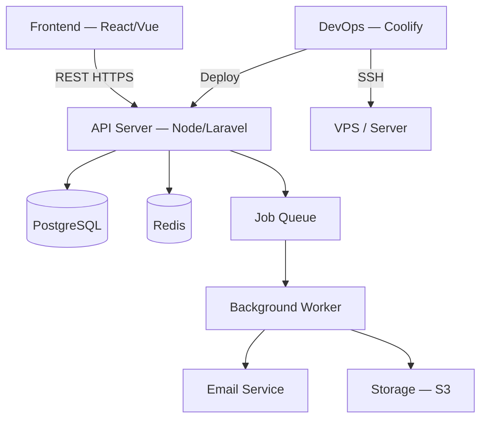

> Last Updated: YYYY-MM-DD | Version: 1.0 | Sprint: [sprint-name]

# [Project Name] — Team Reference

> **Note for tech-writer**: This document is for internal team members. Assume the reader knows the codebase. Focus on decisions, context, and the "why" — not the "what". Update at every sprint close. Replace all `[brackets]` before publishing.

---

## Table of Contents

1. [Current Architecture State](#current-architecture-state)
2. [Architecture Decision Records (ADRs)](#architecture-decision-records)
3. [Module Map & Ownership](#module-map--ownership)
4. [Internal Patterns & Conventions](#internal-patterns--conventions)
5. [Active MCP Servers](#active-mcp-servers)
6. [Active Technical Debt](#active-technical-debt)
7. [Infrastructure & Environments](#infrastructure--environments)
8. [Incident Runbook](#incident-runbook)
9. [Team Contacts & Ownership](#team-contacts--ownership)
10. [Changelog](#changelog)

---

## Current Architecture State

> Update this diagram every sprint if the topology changes.



**System Boundaries:**
- **Frontend**: [Tech, repo, deployment URL]
- **API**: [Tech, repo, deployment URL]
- **Database**: [Engine, version, hosting]
- **Queue**: [Redis / BullMQ — hosting]
- **Storage**: [S3 / local — provider]

---

## Architecture Decision Records (ADRs)

### ADR-001: [Decision Title]

**Date**: YYYY-MM-DD | **Status**: Active

**Context**: [What problem or constraint motivated this decision?]

**Decision**: [What exactly was decided?]

**Consequences**:
- ✅ [Benefit]
- ✅ [Benefit]
- ⚠️ [Trade-off or known limitation]
- 🔧 [Technical debt consciously accepted]

---

### ADR-002: [Decision Title]

**Date**: YYYY-MM-DD | **Status**: Active

**Context**: [Context]

**Decision**: [Decision]

**Consequences**:
- ✅ [Benefit]
- ⚠️ [Trade-off]

---

### ADR-003: [Deprecated Decision Title]

**Date**: YYYY-MM-DD | **Status**: Superseded by ADR-007

**Context**: [Original context]

**Why it was replaced**: [Reason the decision is no longer valid]

---

## Module Map & Ownership

> Who wrote it, who maintains it, what it does.

| Module / Directory | Responsibility | Primary Owner | Notes |
|---|---|---|---|
| `src/auth/` | JWT auth, refresh, session management | [Name] | Uses RBAC pattern |
| `src/payments/` | Stripe integration, webhook handler | [Name] | Idempotency keys on all POST |
| `src/jobs/` | Background queue workers | [Name] | BullMQ. See ADR-003 |
| `mcp/ssh-mcp/` | SSH operations tool for DevOps agent | [Name] | Whitelist-only commands |
| `mcp/coolify-mcp/` | Coolify API integration | [Name] | Requires COOLIFY_API_KEY in .env |
| `[directory]` | [Responsibility] | [Name] | [Notes] |

---

## Internal Patterns & Conventions

### Repository Pattern
All database access goes through Repository classes. Controllers never import the ORM directly:
```
Controller → Service → Repository → ORM (Prisma/Eloquent)
```

### Error Handling Contract
All errors returned from the API follow this shape:
```typescript
{
  success: false,
  status: number,        // HTTP status code
  error_code: string,    // Internal error identifier (SCREAMING_SNAKE_CASE)
  message: string,       // Human-readable message (safe for client consumption)
  trace_id: string,      // Request trace ID for log correlation
  timestamp: string      // ISO 8601
}
```

### Naming Conventions
- **Files**: `kebab-case.ts` for modules, `PascalCase.ts` for classes
- **Database tables**: `snake_case` plural (`user_sessions`, `payment_orders`)
- **API routes**: `/api/v1/resource` (noun, plural, lowercase)
- **Environment variables**: `SCREAMING_SNAKE_CASE`

### Background Jobs
Any operation > 300ms or with external side effects (emails, storage uploads) must be queued:
```typescript
// ✅ Correct: async via queue
await paymentQueue.add('process-refund', { orderId });
return res.status(202).json({ status: 'queued', trace_id });

// ❌ Incorrect: blocking the request thread
await processRefund(orderId);
```

### Feature Flags
New risky features are deployed behind a flag. The flag key format is `feature_[module]_[description]`:
```
feature_payments_stripe_v2
feature_auth_biometric_login
```

---

## Active MCP Servers

| MCP | Folder | Identifier in mcp.json | Tools | Authorized Role |
|---|---|---|---|---|
| SSH Operations | `mcp/ssh-mcp/` | `ssh-wordpress` | `execute_ssh_command` | `devops-sysadmin` |
| Coolify API | `mcp/coolify-mcp/` | `coolify` | `deploy_service`, `get_logs`, `list_services` | `devops-sysadmin` |
| [New MCP] | `mcp/[name]/` | `[id]` | `[tools]` | `[role]` |

**MCP Configuration file**: `.ai/mcp.json`
**Standards reference**: `.ai/02_mcp_standards.md`

---

## Active Technical Debt

> Track all conscious workarounds here. A hidden debt is a ticking bomb.

| ID | Description | Location | Impact if Unresolved | Priority | Added |
|---|---|---|---|---|---|
| `DEBT-001` | MCPs still in `.ai/mcp-servers/` instead of `mcp/` | `.ai/mcp.json` | Config inconsistent with documented standard | 🔴 High | 2026-04-16 |
| `DEBT-002` | No `.env.example` in each MCP folder | `mcp/*/` | Manual onboarding, fragile env setup | 🟡 Medium | 2026-04-16 |
| `DEBT-003` | [Description of debt] | [File/module] | [What breaks if we don't fix this] | [Priority] | [Date] |

**Priority legend**: 🔴 High (blocks or risks production) | 🟡 Medium (degrades DX or safety) | 🟢 Low (cosmetic or minor)

---

## Infrastructure & Environments

| Environment | URL | Hosting | Branch | Deploy Trigger |
|---|---|---|---|---|
| Production | `https://[domain].com` | Coolify VPS | `main` | Auto on merge |
| Staging | `https://staging.[domain].com` | Coolify VPS | `staging` | Auto on merge |
| Local | `http://localhost:3000` | Docker | Any | `npm run dev` |

### Server Access
- **SSH**: Via `mcp/ssh-mcp/` through the `devops-sysadmin` agent
- **Coolify Dashboard**: `https://[coolify-instance]/` (credentials in team vault)
- **Database**: Only accessible from within the VPS internal network. Use SSH tunnel for local inspection.

### Backup Policy
- **Database**: Daily automated backup via Coolify. 7-day retention.
- **Volumes**: Included in Coolify backup. Verify restore monthly.
- **Code**: GitHub is source of truth. No separate code backup needed.

---

## Incident Runbook

### API is returning 500 errors

1. Check API container logs: `docker logs [container-name] --tail 100`
2. Check database connectivity from API container
3. Check environment variables are loaded: `printenv | grep DATABASE`
4. Review last deployment — if recent, consider rollback
5. Escalate if unresolved in 15 minutes

### Database is unreachable

1. SSH into server via `devops-sysadmin` agent
2. Check DB container is running: `docker ps | grep db`
3. Check DB logs: `docker logs [db-container] --tail 100`
4. Verify disk space: `df -h`
5. If disk full: clear logs or extend volume before restart

### Background jobs are stuck

1. Check Redis is running: `docker ps | grep redis`
2. Check queue consumer logs
3. Look for failed jobs in BullMQ dashboard or via `redis-cli`
4. If jobs are stale, flush the specific queue (⚠️ only after confirming with team lead)

### Deployment failed

1. Check CI pipeline logs for exact failure point
2. If build failure: check for dependency conflicts or env var changes
3. If health check failure post-deploy: rollback via Coolify and investigate
4. Document the failure and resolution in `active_context.md`

---

## Team Contacts & Ownership

| Area | Owner | Contact | Backup |
|---|---|---|---|
| Backend API | [Name] | [Email/Slack] | [Name] |
| Infrastructure | [Name] | [Email/Slack] | [Name] |
| Frontend | [Name] | [Email/Slack] | [Name] |
| Product / Requirements | [Name] | [Email/Slack] | [Name] |

**On-call rotation**: [Link to schedule or N/A]
**Escalation path**: [Team member] → [Team lead] → [CTO/Founder]

---

## Changelog

| Version | Date | Sprint | Summary |
|---|---|---|---|
| 1.0 | YYYY-MM-DD | [sprint] | Initial team reference created |
